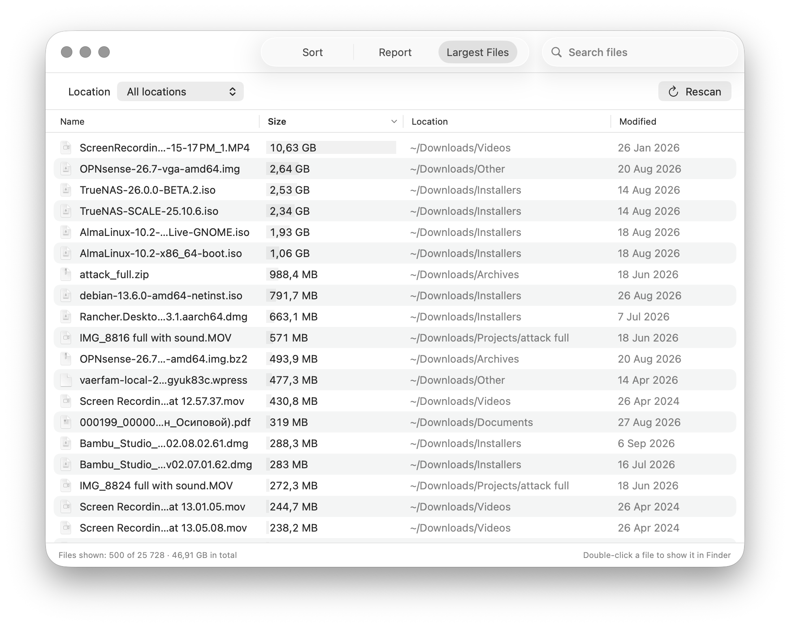
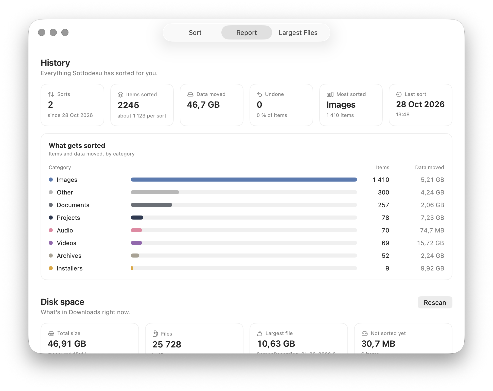
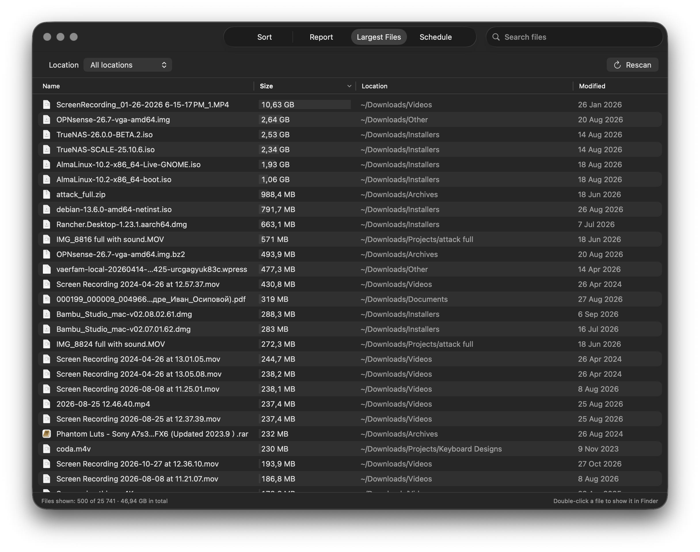
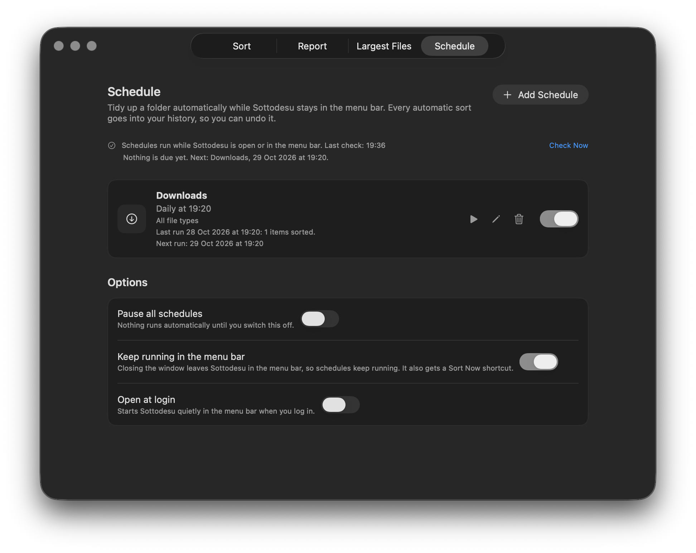

<p align="center">
  
</p>

<h1 align="center">Sottodesu</h1>

<p align="center">
  <b>Tidy up your Mac's folders with one click — and undo it any time.</b>
</p>

<p align="center">
  <a href="https://github.com/lexeremin/Sottodesu/releases/latest"></a>
  <a href="https://github.com/lexeremin/Sottodesu/releases"></a>
  <a href="https://github.com/lexeremin/Sottodesu/actions/workflows/ci.yml"></a>
  <a href="https://github.com/lexeremin/Sottodesu/commits/main"></a>
  <a href="https://github.com/lexeremin/Sottodesu/stargazers"></a>
</p>

<p align="center">
  
  
  <a href="LICENSE"></a>
</p>

<p align="center">
  
</p>

Sottodesu sorts the mess in your **Downloads**, your **Desktop**, your **home folder** or **any folder you pick** into neat folders by type — Images, Documents, Videos, Books and more — and remembers every sort, so you can put things back with a single click.

- 🧹 **One button.** Pick a folder and press *Sort*. That's it.
- 🎯 **You choose.** Sort your Downloads, your Desktop, your home folder (safely limited) or any folder you pick — and only the kinds of files you tick, such as just your photos.
- ↩️ **Always undoable.** Every sort is saved in a history. Undo any of them later.
- 🔐 **Careful with secrets.** Keys, certificates and `.env` files go into their own private folder.
- 🔒 **Private.** Works entirely on your Mac. No account, no internet, no tracking — and it never opens your files, only looks at their names.
- 🌍 **Speaks your language.** English, Русский, 简体中文, 한국어, 日本語 and Français — even the folders it creates are named in your language.
- 👀 **Look first.** *Preview* shows exactly what would move before anything does, and *Search history* finds where any file went.
- ⏰ **Automatic if you like.** Schedule a daily, weekly or monthly tidy-up. Every automatic sort can be undone too.
- 🪶 **Light.** One small window. An optional menu bar icon and nothing else running — unless you add a schedule and keep Sottodesu in the menu bar.

Free and open source. Requires **macOS 15 or later** (Apple silicon or Intel).

---

## Install

1. **[Download the latest release](https://github.com/lexeremin/Sottodesu/releases/latest)** — get the file ending in `.dmg` from the *Assets* list.
2. **Open the downloaded file** and double-click **Sottodesu**. It offers to **move itself to Applications**; say yes and it reopens from there, ejects the installer and moves the downloaded `.dmg` to the Trash. *(Prefer to do it yourself? Drag **Sottodesu** onto the **Applications** folder instead.)*
3. Next time, open Sottodesu from your Applications folder (or Launchpad).

### The quickest way: one command

Open **Terminal** (⌘ Space, type *Terminal*), paste this line and press Return. It downloads the latest release and installs it, and **macOS doesn't show any warning**:

```
/bin/bash -c "$(curl -fsSL https://raw.githubusercontent.com/lexeremin/Sottodesu/main/Scripts/install.sh)"
```

### Opening it for the first time

Sottodesu isn't registered with Apple yet (that costs money; this is a free project), so macOS asks you to approve it **once**:

1. Try to open Sottodesu. macOS says it *"could not be verified"* or *"cannot be opened"*. Click **Done**. *(Don't click "Move to Trash".)*
2. Open **System Settings ▸ Privacy & Security**.
3. Scroll down to the **Security** section. Next to *"Sottodesu was blocked…"* click **Open Anyway**.
4. Confirm with your password or Touch ID, then click **Open**.

After that it opens normally. Prefer the Terminal? This does the same thing:

```sh
xattr -dr com.apple.quarantine /Applications/Sottodesu.app
```

Stuck? See [Troubleshooting](docs/TROUBLESHOOTING.md).

---

## Your first sort

1. Open Sottodesu. **Downloads** is already selected — press **Sort Downloads**.
2. The first time you sort Downloads, your Desktop or your Documents (or a folder on an external drive), macOS asks whether Sottodesu may access it. Click **Allow** — it can't work without it.
3. Done. Sottodesu tells you what it sorted, with an **Undo** link right there in case you change your mind.

Sottodesu only looks at the **top level** of the folder you choose, and it only **moves** things — it never deletes or overwrites anything. If two files would end up with the same name, the second one becomes `photo 2.jpg`.

It deliberately leaves alone:

- files that are still downloading (and anything changed in the last few seconds),
- apps (`.app`) and symbolic links,
- hidden **folders**, and the hidden clutter macOS creates by itself (`.DS_Store`, `.localized`, `._…`),
- the folders it created itself.

> **Hidden files** such as `.gitignore` or `.zshrc` are sorted in **Downloads** — into **Config & VPN**, or into **Keys & Secrets** if they hold credentials (`.env`, `.npmrc`…). They stay hidden after they move; press **⌘⇧.** in Finder to show them. Desktop, Home and folders you pick leave hidden files alone.

## Choose what to sort

At the top of the *Sort* tab you pick **where** to sort and **what** to sort. It remembers your choice.

**Where to sort**

| Card | What it does |
|---|---|
| **Downloads** | Everything, sorted by type. |
| **Desktop** | The same for your desktop. Hidden files are left alone. |
| **Home** | Your home folder — **restricted on purpose**, because it's full of settings. Only *loose media and documents* are moved: photos to **Pictures**, videos to **Movies**, music to **Music**, and documents, books, archives, installers, 3D models and design files into **Documents** (so your home folder never gets new clutter). Hidden files (`.zshrc`, `.ssh`…), folders, apps, code, databases, configuration, keys and secrets, fonts and your Library are **never** touched. |
| **Choose Folder…** | Any other folder, including on an external drive. Sottodesu refuses system folders, apps, your Library and hidden folders, and **asks first** if the folder looks like a software project (a `.git` folder, `package.json`, an Xcode project…) because moving files around can break one. |

**What to sort**

Two cards: **Everything** (the default — every type of file) or **Selective**. Choose *Selective* and a row of file types appears; tick only the ones you want — say just **Images** and **Documents**. **Reset** clears your ticks so you can start over. Under the Sort button, Sottodesu always tells you exactly what it's about to do.

Every sort in the history shows which folder it was for, and **Report** and **Largest Files** follow the folder you've selected.

## Preview before you sort

Not sure what a sort will do? Press **Preview…** under the Sort button. Sottodesu lists every file it would move, grouped by type, and **nothing moves yet**. Untick anything you want to leave where it is, then press **Sort**.

## Undo

Every sort appears under **History** on the *Sort* tab. Click a sort to see exactly what it moved, and press **Undo** to put everything back where it was. If you've since moved or deleted something, Sottodesu skips it and tells you — it never overwrites anything while undoing.

You don't have to undo a whole sort. Open a sort and press **Restore these** to put back just one type of file, or use **Search history** to find a single file (*"where did report.pdf go?"*) and restore only that.

---

## Tidy up automatically

Open the **Schedule** tab, press **Add Schedule**, and pick a folder, which file types, and how often: **daily, weekly or monthly**, at a time you choose. Sottodesu checks every minute and sorts the folder when its time comes, then sends a notification if it moved something.

**Schedules run while Sottodesu is running.** To keep it going after you close the window, switch on **Keep running in the menu bar** on the Schedule tab: Sottodesu then stays in the menu bar (and out of the Dock) with a *Sort Now* shortcut. Switch on **Open at login** to have it start quietly in the menu bar whenever you log in.

- Every automatic sort is saved in your history, marked *Scheduled*, so you can look at it or undo it like any other.
- Files newer than ten minutes are left alone, so something you just downloaded isn't swept away. If your Mac was asleep or Sottodesu wasn't running at the set time, the sort runs as soon as it can.
- **Pause all schedules** stops everything with one switch.
- Deleting the schedules, or using **Uninstall Sottodesu…**, leaves nothing running.

## A quick tour

### Choose where and what — then take it back if you like

The **Sort** tab (shown at the top) is where you pick a folder, choose *Everything* or *Selective*, and press the button. Below it, every sort is saved as a card with a colour bar showing what went where and which folder it was for. Open one to see every item and its size, or press **Undo**.

### Understand your folder

The **Report** tab shows how much Sottodesu has sorted, which categories you use most, and where the space in the selected folder actually goes.

<p align="center">
  
</p>

### Find the big files

**Largest Files** lists the biggest files in the selected folder, biggest first. **Double-click a file to show it in Finder.** Right-click for *Open* and *Copy Path*; click a column to sort, or just search.

<p align="center">
  
</p>

### Let it tidy up for you

The **Schedule** tab keeps a folder tidy automatically: pick a folder, the file types and how often, and Sottodesu does the rest from the menu bar. Pause everything with one switch.

<p align="center">
  
</p>

Tip: ⌘1 / ⌘2 / ⌘3 / ⌘4 switch tabs, ⌘R rescans.

---

## What goes where

These are the folders Sottodesu sorts into in Downloads, on your Desktop and in any folder you choose. (Your home folder works differently — see [Choose what to sort](#choose-what-to-sort).)

| Folder | What's in it |
|---|---|
| **Images** | photos, screenshots, RAW photos (jpg, png, heic, svg, arw, cr3, nef, dng…) |
| **Videos** | mp4, mov, mkv, avi, webm… |
| **Audio** | mp3, m4a, wav, flac… |
| **Documents** | pdf, Word, Excel, PowerPoint, Pages, Numbers, Keynote, txt, md, csv… |
| **Books** | epub, mobi, azw3, kfx, fb2, djvu, cbz, cbr… |
| **Archives** | zip, rar, 7z, tar, gz… |
| **Installers** | dmg, pkg, iso |
| **3D Models** | stl, 3mf, obj, step, gcode, blend, fbx, glb… |
| **Databases** | sqlite, db, mdb, accdb, SQL dumps, Anki decks (apkg)… |
| **Config & VPN** | ovpn, conf, mobileconfig, json, yaml, toml, plist… and **hidden "dot" files** like `.gitignore`, `.zshrc` |
| **Keys & Secrets** | `.env` and `.env.*`, certificates and keys (cert, pem, crt, cer, p12, pfx, SSH keys), `.npmrc`, `.netrc`, password databases… |
| **Code** | py, js, ts, swift, c, cpp, rs, go, sh, ipynb… |
| **Fonts** | ttf, otf, woff, woff2 |
| **Design** | psd, ai, sketch, fig, xd… |
| **Projects** | any loose folder |
| **Other** | everything else |

**Keys & Secrets** is created so that only your user account can open it. Sottodesu never reads what's inside these files — it only moves them, so they don't sit loose among your files. (Template files like `.env.example` aren't secret and go to Config & VPN.)

## Languages

Sottodesu follows your Mac's language (System Settings ▸ General ▸ Language & Region). The window **and the folders it creates** use that language:

| | English | Русский | 简体中文 | 한국어 | 日本語 | Français |
|---|---|---|---|---|---|---|
| Images | Images | Изображения | 图片 | 이미지 | 画像 | Images |
| Videos | Videos | Видео | 视频 | 동영상 | 動画 | Vidéos |
| Audio | Audio | Аудио | 音频 | 오디오 | オーディオ | Audio |
| Documents | Documents | Документы | 文档 | 문서 | 書類 | Documents |
| Books | Books | Книги | 图书 | 도서 | 書籍 | Livres |
| Archives | Archives | Архивы | 压缩包 | 압축 파일 | アーカイブ | Archives |
| Installers | Installers | Установщики | 安装程序 | 설치 파일 | インストーラ | Installateurs |
| 3D Models | 3D Models | 3D-модели | 3D 模型 | 3D 모델 | 3Dモデル | Modèles 3D |
| Databases | Databases | Базы данных | 数据库 | 데이터베이스 | データベース | Bases de données |
| Config & VPN | Config & VPN | Конфиги и VPN | 配置与 VPN | 설정 및 VPN | 設定とVPN | Config et VPN |
| Keys & Secrets | Keys & Secrets | Ключи и секреты | 密钥与机密 | 키 및 보안 정보 | 鍵と機密情報 | Clés et secrets |
| Code | Code | Код | 代码 | 코드 | コード | Code |
| Fonts | Fonts | Шрифты | 字体 | 글꼴 | フォント | Polices |
| Design | Design | Дизайн | 设计 | 디자인 | デザイン | Design |
| Projects | Projects | Проекты | 项目 | 프로젝트 | プロジェクト | Projets |
| Other | Other | Другое | 其他 | 기타 | その他 | Autres |

If you change your Mac's language later, nothing breaks: Sottodesu recognises folders it made in *any* of these languages and keeps using them, so you never end up with two sets. Chinese means Simplified Chinese; Traditional Chinese isn't included yet.

Want another language? See [Translating](docs/DEVELOPING.md#adding-or-fixing-a-translation).

---

## Privacy

- Sottodesu **never connects to the internet.** There is no account, no analytics and no update check.
- It only looks at **file names** inside the folder you choose and moves files. It **never opens or reads what's inside them.**
- The only thing it stores is its history, your last choices and your schedules — in one small file at `~/Library/Application Support/Sottodesu/history.sqlite`. Nothing runs in the background except Sottodesu itself, and only if you choose to keep it in the menu bar.

## Uninstall

**The easy way:** choose **Sottodesu ▸ Uninstall Sottodesu…** from the menu bar. It removes Sottodesu's history, schedules and settings, takes it out of your login items, and moves the app to the Trash. Files that were already sorted stay where they are, but you can no longer undo past sorts, so press *Undo* first if you want something back.

Just dragging the app to the Trash works too, but it **leaves the history file behind**, because macOS gives apps no chance to clean up after themselves. If you reinstall later, Sottodesu will remember everything.

### Remove every trace by hand

| What | Where |
| --- | --- |
| The app | `/Applications/Sottodesu.app` |
| History, schedules and settings (the only file Sottodesu creates) | `~/Library/Application Support/Sottodesu/` |
| Small files macOS may add | `~/Library/Preferences/dev.sottodesu.app.plist`, `~/Library/Caches/dev.sottodesu.app`, `~/Library/HTTPStorages/dev.sottodesu.app`, `~/Library/Saved Application State/dev.sottodesu.app.savedState` |
| *Open at login* | **System Settings ▸ General ▸ Login Items & Extensions** — switch Sottodesu off (Uninstall does this for you) |
| Permissions you granted | **System Settings ▸ Privacy & Security ▸ Files & Folders** and **Notifications** |

Or do it all in one go. Paste this into **Terminal**:

```sh
osascript -e 'quit app "Sottodesu"'
rm -rf /Applications/Sottodesu.app \
       ~/Library/Application\ Support/Sottodesu \
       ~/Library/Preferences/dev.sottodesu.app.plist \
       ~/Library/Caches/dev.sottodesu.app \
       ~/Library/HTTPStorages/dev.sottodesu.app \
       ~/Library/Saved\ Application\ State/dev.sottodesu.app.savedState
tccutil reset All dev.sottodesu.app
```

The last line forgets the folder and notification permissions you gave Sottodesu. The folders Sottodesu created while sorting (*Images*, *Documents* and so on) are your own files and stay where they are.

## Help

- 🛟 [Troubleshooting](docs/TROUBLESHOOTING.md) — the most common problems and fixes
- 🐞 [Report a problem or suggest something](https://github.com/lexeremin/Sottodesu/issues/new)
- 🛠 [Build it yourself / contribute](docs/DEVELOPING.md)
- 📝 [What's new](CHANGELOG.md)

## License

Sottodesu is free and open source under the [MIT License](LICENSE).
